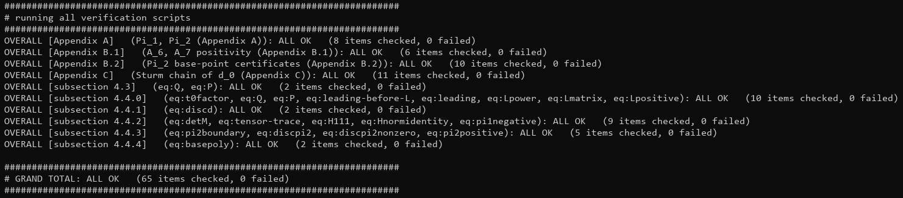

# Symbolic verification of the upper-bound algebra

Exact SymPy verification of the upper-bound algebra of

> The optimal barrier parameter of the three-dimensional power cone

The scripts cover subsection 4.3, subsection 4.4 with all of its subsections,
and Appendices A-C: the algebraic identities, the factorisations and the sign
certificates on which the proof of the upper bound rests.  Everything is
computed in exact arithmetic (rational numbers and polynomials), so no
numerical tolerance is involved.  Every equality verdict is decided by exact
normalisation of the difference -- `is_zero` and `clear_denominator` in
`checks/_common.py` -- and `sp.simplify` is not used anywhere in the suite.

Two kinds of statements are deliberately outside this scope.  The lower bound
of Section 3 and the combination of the two bounds in Section 5 are not
covered here: their algebra is proved by hand in the paper.  And within the
sections that are covered, the steps that are not algebraic -- the real-root
continuation of `lem:root-continuation` and `lem:compactcontinuation`, the
Sylvester step of `lem:Qpd`, and the passage from an identity to a sign
statement -- remain the paper's own arguments; what the scripts check is every
ingredient those arguments use, not the arguments themselves.

## Requirements

* Python 3
* SymPy

## How to run

Run one part of the paper:

```sh
python checks/sec4_3.py
```

Run everything:

```sh
python run_all.py
```

## How to read the output

The two entry points use the same exact arithmetic and check the same
statements; they differ only in how much they print.  The suite contains no
floating-point arithmetic at all: every quantity is an integer, a rational
number or a polynomial, and every verdict is an exact algebraic decision --
polynomial normalisation, Sturm root counting, Bernstein signs, or a
remainder-checked division.

### Detailed output: a single script

Running one script prints a banner naming the part of the paper and the
labelled equations it checks, the value computed by SymPy for each ingredient,
and one verdict per statement:

```
========================================================================
Checking subsection 4.4.4: eq:basepoly
only python-computed values are printed; compare them with the paper
========================================================================

d_0(xi) = (729/2)*d_{1/3,1/2}(xi)   (degree 6 in xi):
   [xi^6] = 17914752
   [xi^5] = -5322240
   ...
   [OK ] eq:basepoly   d_0
   [OK ] eq:basepoly   d_0(0) = 66199 > 0

========================================================================
OVERALL [subsection 4.4.4]   (eq:basepoly): ALL OK   (2 items checked, 0 failed)
========================================================================
```

Only values computed by SymPy are printed: the formulas of the paper occur
only inside comparisons and are never echoed, so each line can be compared
with the displayed formula of the paper.  A verdict is `[OK ]` or `[BAD]`.

The formula list shown with each banner names the labelled statements that
receive a verdict in that script, so the number of items is not the number of
equations mentioned: definitions (`eq:Htensor`, `eq:tensor-M-norm`) and the
intermediate forms used to build an object appear in the header of the script,
not as a separate line.  A few verdicts are compositions of the paper's proof
steps (`eq:pi2positive`, which rests on Lemma lem:compactcontinuation, and
`eq:pi1negative`, which rests on Lemma lem:Qpd): every ingredient is checked
exactly, while the elementary continuation or linear-algebra step that combines
them is the one the paper takes.

### Summary output: run_all.py

`python run_all.py` runs the same scripts but captures their detailed output
and prints only the `OVERALL` line of each part, followed by the grand total:

```
########################################################################
# running all verification scripts
########################################################################
OVERALL [Appendix A]   (Pi_1, Pi_2 (Appendix A)): ALL OK   (8 items checked, 0 failed)
OVERALL [Appendix B.1]   (A_6, A_7 positivity (Appendix B.1)): ALL OK   (6 items checked, 0 failed)
...
OVERALL [subsection 4.4.4]   (eq:basepoly): ALL OK   (2 items checked, 0 failed)

########################################################################
# GRAND TOTAL: ALL OK   (65 items checked, 0 failed)
########################################################################
```

A failure is never hidden: what is captured is only the detailed value lines,
while the `OVERALL` and `FAILED` lines and the grand total are always printed.
Run an individual script when the intermediate values of one part are needed.

## Scripts

The individual checks are in the `checks/` folder.

| Script | Part of the paper | Items | Result |
|---|---|---|---|
| `appendix_a.py` | Appendix A | 8 | ALL OK |
| `appendix_b1.py` | Appendix B.1 | 6 | ALL OK |
| `appendix_b2.py` | Appendix B.2 | 10 | ALL OK |
| `appendix_c.py` | Appendix C | 11 | ALL OK |
| `sec4_3.py` | subsection 4.3 | 2 | ALL OK |
| `sec4_4_0.py` | subsection 4.4.0 | 10 | ALL OK |
| `sec4_4_1.py` | subsection 4.4.1 | 2 | ALL OK |
| `sec4_4_2.py` | subsection 4.4.2 | 9 | ALL OK |
| `sec4_4_3.py` | subsection 4.4.3 | 5 | ALL OK |
| `sec4_4_4.py` | subsection 4.4.4 | 2 | ALL OK |

65 items in total.  `sec4_4_1.py` is the slow one (about two minutes) and
`sec4_4_2.py` takes about fifteen seconds; the others finish in a few
seconds.

## Verification results

Running `python run_all.py` checks all 65 items and, for each part of the
paper, reports the section, the labelled equations and the verdict:



The recorded run used Python 3.13 and SymPy 1.14, and `run_all.py` ends with

```
########################################################################
# GRAND TOTAL: ALL OK   (65 items checked, 0 failed)
########################################################################
```

Each part terminates with its own `ALL OK (0 failed)` summary, for example

```
OVERALL [Appendix B.2]   (Pi_2 base-point certificates (Appendix B.2)): ALL OK   (10 items checked, 0 failed)
OVERALL [subsection 4.4.1]   (eq:discd): ALL OK   (2 items checked, 0 failed)
```

## Notes

* `checks/_common.py` collects the shared symbols, the barrier and the auxiliary polynomials, together with the printing, Sturm and Bernstein helpers and the two exact decision procedures `is_zero` and `clear_denominator`.  It is imported by the scripts above and is not meant to be run on its own.

## License

Released under the MIT License.  See `LICENSE`.

Copyright (c) 2026 Rui-Jin Zhang, Wenhao Fu, and Yu-Hong Dai.
